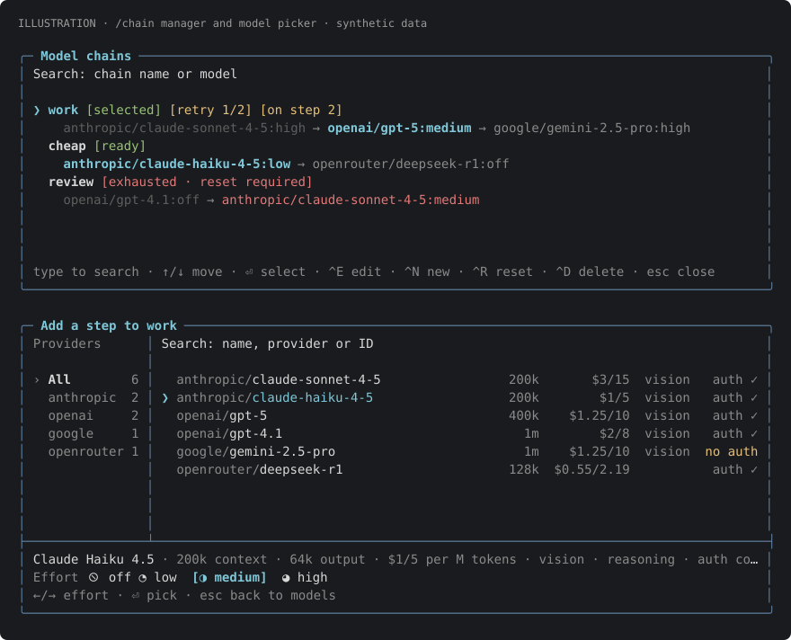

# @howarewoo/pi-model-chain

[](https://www.npmjs.com/package/@howarewoo/pi-model-chain)
[](https://www.npmjs.com/package/@howarewoo/pi-model-chain)

A [Pi coding agent](https://pi.dev) extension that lets you pick a named list of models, called a chain, and moves to the next model on the list when the current one keeps failing or runs out of credit.



_The `/chain` overlay and model picker, rendered from the production components with synthetic data. Not a terminal screenshot._

## Why use it

Pi's own retries try the same model again. When a provider is down or your credit runs out, you have to notice and switch models yourself. A chain does that switch for you:

- Each model in the chain gets one attempt and two retries. If all three fail with a provider outage, a dropped connection or a quota or credit error, Pi moves to the next model.
- A backup that works stays selected for later turns until you run `/chain-reset`.
- Pi only moves to the models you listed, in your order. Logging in to a provider never adds it to a chain.
- Login, permission and bad-request errors, refusals and cancellations stop the chain. Pi doesn't hop to another provider to get around them.
- Each session remembers where its chain is, even after `/reload`, a resumed session or compaction.
- You build and edit chains in the [`/chain` overlay](docs/chain-manager.md), or in one JSON file.

Chains apply to the main Pi session only. Picking a single model turns the chain off, and subagents don't use your chain. If you use [pi-subagents](https://github.com/howarewoo/pi-subagents), give its profiles their own fallback chains ([how the two fit together](docs/coexistence.md)).

## Project status

Actively maintained, with releases below 1.0 (the npm badge shows the current version). It needs Node 22.19 or newer and is tested with Pi 1.6.0. Other Pi versions haven't been tested. Before 1.0, a minor release can change behavior, so read the [update notes](docs/installation.md#updates-and-rollback) before upgrading.

## Install

```sh
pi install npm:@howarewoo/pi-model-chain
```

To install from Git instead, run `pi install git:github.com/howarewoo/pi-model-chain`. Install from only one source, or Pi loads the extension twice. Extensions run with the same system permissions as Pi, so review the source before installing. See [installation and updates](docs/installation.md) for updates, pinned versions and rollback.

## Quick start

Log in to the providers you want to use with Pi's `/login` command, then find their exact model IDs with `pi --list-models`.

Create `~/.pi/agent/model-chain.json` with your chain. Replace these example IDs with yours:

```json
{
  "version": 1,
  "chains": {
    "work": [
      { "provider": "anthropic", "model": "claude-sonnet-4-5", "effort": "high" },
      { "provider": "openai", "model": "gpt-4.1", "effort": "off" }
    ]
  }
}
```

Every provider you list can receive your conversation, so list only ones you trust with it.

Run a request through the chain:

```sh
pi --model chain/work -p "Say hello in five words"
```

Pi answers with the first model. If that model fails three times in a row with an outage or quota error, Pi sends the request to the next one. In an interactive session, pick `chain/work` in `/model` or `/chain` (run `/reload` first if Pi was already open) and use these commands:

```text
/chain         # create, edit, select and delete chains
/chain-status  # show each step, the retries used and any warnings
/chain-reset   # go back to the first model in the selected chain
```

The [usage guide](docs/usage.md) covers the full setup, including the retry settings to leave alone.

## Documentation

| Topic                                                                                 | What it covers                                                   |
| ------------------------------------------------------------------------------------- | ---------------------------------------------------------------- |
| [Using model chains](docs/usage.md)                                                   | Full setup, retry settings, status, reset and changed chains     |
| [Manage chains with /chain](docs/chain-manager.md)                                    | The overlay, its keys, the model picker and saving               |
| [Configuration reference](docs/configuration.md)                                      | Every field in `model-chain.json` and how model scopes apply     |
| [Recovery and safety](docs/recovery.md)                                               | Which failures switch models, retry counting, cost and tool runs |
| [Troubleshooting](docs/troubleshooting.md)                                            | Common problems and how to fix them                              |
| [Installation and updates](docs/installation.md)                                      | Host support, install sources, updates, pinning and rollback     |
| [Coexistence with pi-subagents](docs/coexistence.md)                                  | Running both extensions together                                 |
| [Local development](docs/development.md)                                              | Checks, tests and the package test                               |
| [Releases](docs/releases.md) and [changelog](CHANGELOG.md)                            | Publishing process and user-facing changes                       |
| [Security policy](SECURITY.md)                                                        | Reporting vulnerabilities and trust boundaries                   |
| [Contribution rules](https://github.com/howarewoo/pi-model-chain/blob/main/AGENTS.md) | PR titles and changelog policy                                   |

## License

MIT. See [LICENSE](LICENSE).
