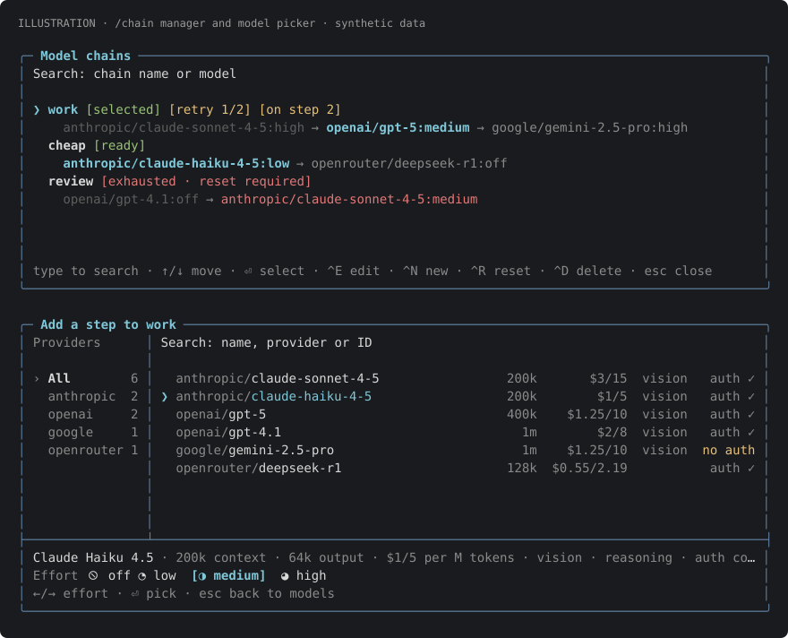

# Manage chains with /chain

The `/chain` overlay lets you create, edit, reorder, select, reset and delete chains without editing JSON.

_The `/chain` overlay and model picker, rendered from the production components with
synthetic data. Not a terminal screenshot._

`/chain` opens a framed, keyboard-driven overlay. The search box has focus: type to filter
chains by name or model. Each row shows the chain's badges (`selected`, `ready`,
`retry 1/2`, `on step 2`, `N skipped`, `exhausted` or `changed`) and its ordered steps as
`provider/model:effort → …`, with the active step highlighted.

| Key           | List                                | Chain editor                             |
| ------------- | ----------------------------------- | ---------------------------------------- |
| `↑`/`↓`       | Move                                | Move between the name and steps          |
| `Enter`       | Select the chain for this session   | Replace the step via the model picker    |
| `^E` / `^N`   | Edit the chain / create a chain     | `^N` (or `a`) adds a step after this one |
| `Shift+↑`/`↓` |                                     | Reorder the step                         |
| `x`/`Delete`  |                                     | Remove the step                          |
| `^R`          | Reset the chain on this idle branch |                                          |
| `^D`          | Delete the chain (asks to confirm)  |                                          |
| `^S`          |                                     | Validate and save                        |
| `Esc`         | Close                               | Back; asks again if edits are unsaved    |

The **model picker** lists the same models as Pi's built-in `/model` picker: the models
scoped for this session with `--models` or `enabledModels` (as `/scoped-models` shows), or,
with no scope set, the models Pi has authentication for. Models and providers outside that
set are hidden. A **Providers** column on the left lists `All` first, then each listed provider
with its count of models matching the search; the search box and model rows on the right show
only the selected provider's models. Rows show context window, price per million tokens, vision
support and whether authentication is configured.

| Key     | Model picker                                                         |
| ------- | -------------------------------------------------------------------- |
| `←`/`→` | Move between the provider column and the model list                  |
| `↑`/`↓` | Move within the focused column (the model list follows the provider) |
| Typing  | Edit the search; focus returns to the model list                     |
| `Enter` | From Providers, go to the models; on a model, open the effort strip  |
| `Esc`   | Close the effort strip, then leave the picker                        |

Frames narrower than 72 columns show the provider as a single `Provider` row above the search,
with the same keys.

`Enter` on a model opens an inline strip with only the efforts that model supports and the
session scope allows (a scope such as `anthropic/*:high` offers only `high`); `←`/`→` choose one
and `Enter` adds it. Virtual models, models with unknown limits and targets already in the
chain stay visible with an inline reason but cannot be picked. A scoped model without
configured authentication can be added but is skipped at runtime until you log in. A chain
that already has a step outside the session scope still appears in the list, and the editor
marks that step so you can fix it; the chain is refused before dispatch until you do. `Esc` closes the strip, then returns to the editor with your edits intact.

Saving validates the chain (name, at least one step, no duplicates or virtual targets),
writes `model-chain.json` atomically with owner-only permissions, and registers or removes
the `chain/<name>` models without a reload. It refuses to overwrite a file that changed on
disk since `/chain` opened it, and saving, resetting or deleting requires an idle session.
The selected chain cannot be renamed or deleted; select another model first. Deleting the
last chain removes the file. Outside the interactive UI, `/chain` prints the same summary
as `/chain-status`.
